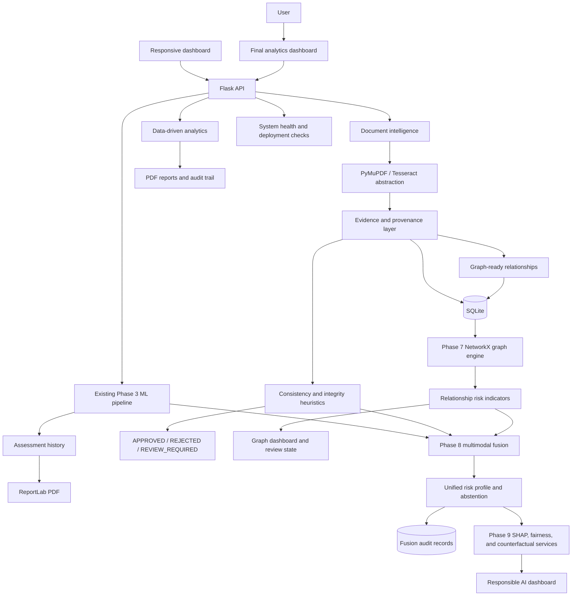

# LoanLens Architecture

The model decision and evidence review state are intentionally separate. The prediction is produced by the existing trained pipeline; document quality and contradictions can request human review without pretending that evidence heuristics are a lending probability.

Phase 7 adds graph nodes and relationship analysis above the evidence layer. Graph reuse and shared-entity patterns are explainable risk indicators, not fraud conclusions.

Phase 8 combines ML, evidence, and graph indicators using configurable engineering weights. The fusion layer preserves component provenance and can return `REVIEW_REQUIRED` when confidence is low or signals disagree.

Phase 9 adds model-compatible SHAP explanations, optional LIME status, validated counterfactual simulation, dataset-specific fairness metrics, model-card metadata, and explanation audit records.

Phase 10 adds the executive analytics layer, application filtering, final reporting, audit/health APIs, upload hardening, responsive charts, and Gunicorn/Docker deployment scaffolding.
