# Phase 6: Advanced Document AI and Evidence-Aware Credit Intelligence

## Objective

Phase 6 adds a proposed evidence-aware architecture around the existing LoanLens model. Documents are processed locally, extracted values retain provenance, and conflicts can request human review without changing the trained model's approval prediction.

This is an academic decision-support system. It is not automatic lending, KYC, Aadhaar/PAN verification, regulatory compliance, or definitive fraud/forgery detection.

## Architecture and pipeline

```mermaid
flowchart LR
    U[PDF/JPG/PNG upload] --> V[Extension and size validation]
    V --> S[Safe local storage and SHA-256]
    S --> P[PDF text or OCR processor]
    P --> E[Field extraction and normalization]
    E --> C[Confidence and integrity signals]
    C --> D[(SQLite evidence layer)]
    D --> X[Cross-document consistency]
    X --> R[Evidence score and review state]
    R --> M[Existing ML prediction]
    M --> H[(Assessment history)]
    H --> PDF[PDF report]
```



`document_intelligence.py` owns file validation, extraction, hashes, and lightweight field extraction. `phase6_analysis.py` owns confidence, integrity signals, consistency checks, score calculation, selective review, and graph-edge preparation.

## OCR and extraction

Text-native PDFs use PyMuPDF. Scanned PDFs and images use `pytesseract` with the native Tesseract executable. If Tesseract is unavailable, image/scanned processing returns setup guidance instead of a fabricated extraction. Extractors are intentionally label-based and incomplete; every field is editable before assessment.

The supported document categories are Salary Slip, Bank Statement, Income/ITR Document, Employment Letter, Identity Document (Demo), and Other Supporting Document.

## Evidence provenance

Each extracted field is stored in `evidence_records` with an evidence ID, document ID, application ID, field name, extracted and normalized values, page number, optional bounding box, confidence, method, verification status, and timestamp. Normal API responses return metadata and previews, not raw document content.

## Consistency and score

The initial engine compares income values across uploaded documents and can compare declared values when supplied by a future application flow. It also checks employer disagreement. Thresholds are explicit in `phase6_analysis.py`: 15% is the configurable review boundary and 30% is the high-conflict boundary for the current heuristic. These are engineering defaults, not universal financial standards.

The Evidence Consistency Score is a transparent 0–100 heuristic. It subtracts configured penalties for LOW/MEDIUM/HIGH/CRITICAL conflicts, integrity warnings, and low extraction confidence. It is not a probability and has not been scientifically validated.

## Integrity and human review

The system records file hashes, image dimensions, empty extraction, and repeated labels as NORMAL, WARNING, or REVIEW_REQUIRED signals. These signals cannot prove document tampering. `REVIEW_REQUIRED` is triggered by high conflicts, critical integrity signals, or low confidence. It does not override or retrain the ML model; it is a separate safe state for human review.

## Privacy and security foundation

Use synthetic or anonymized documents only. Filenames are sanitized, uploads are size-limited to 10 MB, raw files live under ignored local `instance/uploads/`, and hashes are stored for duplicate detection. Raw contents are not logged. A retention/deletion policy should be configured before any non-demo deployment.

## API

- `POST /api/documents/upload` or `POST /api/documents`: multipart upload with `documents`, optional `document_type`, and optional `application_id`.
- `GET /api/documents/<application_id>`: document metadata.
- `POST /api/documents/<application_id>/process`: lifecycle placeholder for future queued processing.
- `GET /api/evidence/<application_id>`: field-level provenance.
- `GET /api/consistency/<application_id>`: structured consistency checks.
- `GET /api/document-integrity/<application_id>`: integrity signals.
- `GET /api/application/<application_id>/evidence-summary`: score, confidence, review state, and graph edges.
- `GET /api/application/<application_id>/graph`: graph-ready relationships.
- `POST /api/assess`: runs the existing prediction model and persists assessment history.
- `GET /reports/<assessment_id>.pdf`: generated assessment report.

## Database schema

SQLite is used because the existing project is local and had no production database. The Phase 6 tables are `applications`, `documents`, `evidence_records`, `consistency_checks`, `integrity_checks`, and `graph_edges`. Existing `assessments` remains compatible with Phase 5.

## Testing

Run synthetic tests with:

```powershell
.\venv\Scripts\python.exe -m unittest discover -s tests -p "test_*.py" -v
```

The tests cover existing routes, prediction preservation, upload validation, PDF extraction, evidence provenance, income mismatch, graph API, and PDF report output. No real personal documents are used.

## Limitations and future Phase 7 integration

OCR quality depends on Tesseract installation and source quality. The extractor does not perform table understanding, identity verification, or definitive fraud detection. Employer and income consistency checks are heuristics. Bounding boxes are reserved but not populated by the current extractor. Phase 7 can consume the graph-ready edge records for relationship analysis without replacing the Phase 3 model.
