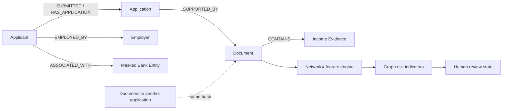

# Phase 7: Graph-Based Credit Risk and Fraud Relationship Analysis

## Objective

Phase 7 adds a lightweight, proposed relationship-analysis layer to LoanLens. It connects applicants, applications, employers, documents, income evidence, and future masked bank entities. Graph signals support human review; they do not prove fraud and do not replace the trained Gradient Boosting model.

## Graph architecture



SQLite stores `graph_nodes` and existing Phase 6 `graph_edges`. NetworkX builds an in-memory `MultiDiGraph` for each request. IDs and metadata are safe labels; raw document content and full account identifiers are not returned.

## Nodes and edges

Node types: `Applicant`, `Application`, `Employer`, `Document`, `IncomeEvidence`, and reserved `BankEntity`.

Relationships include `SUBMITTED`, `HAS_APPLICATION`, `EMPLOYED_BY`, `SUPPORTED_BY`, and `CONTAINS`. Edges can reference Phase 6 `evidence_id` values.

## Features and signals

The engine calculates node degree, relationship count, node count, connected component size, connected application count, document reuse count, shared entity count, neighborhood size, and suspicious cluster size. A shared employer alone is normal and produces only an informational relationship signal.

Document reuse compares Phase 6 file hashes across applications. A reused fingerprint creates a `Document Reuse` signal. A reused document combined with a shared employer creates a stronger relationship signal. Existing Phase 6 high-severity evidence conflicts are also included.

## Graph Risk Score

The score is a configurable 0–100 indicator, not a fraud probability. Current weights are in `settings/graph_settings.py`:

- Document reuse: 35 per reused fingerprint, capped by score bounds
- Shared entity: 10 informational contribution
- Shared entity plus reused document: 25
- Phase 6 high-severity conflict: 20

The engine clamps the result to 0–100 and explains each contribution. `REVIEW_REQUIRED` is returned for significant graph indicators combined with reuse or high-severity evidence conflicts. No `FRAUD_CONFIRMED` state exists.

## Explainability and APIs

- `GET /api/graph/<application_id>` returns safe nodes, relationships, features, and risk analysis.
- `GET /api/graph/<application_id>/features` returns graph features.
- `GET /api/graph/<application_id>/risk` returns score, signals, and review state.
- `GET /api/graph/<application_id>/signals` returns structured signals.
- `GET /api/graph/<application_id>/explanation` returns human-readable reasons.

The dashboard renders the per-application graph with Cytoscape.js, including zoom/pan, relationship labels, node colors, risk metrics, and signal explanations.

## Synthetic scenarios and tests

`tests/test_phase7.py` uses synthetic IDs such as `app_normal`, `Employer_001`, and `hash_shared`. Scenarios cover normal applicants, shared employers, document reuse, shared entity plus reuse, empty graphs, bounded scores, and explanations.

Run:

```powershell
.\venv\Scripts\python.exe -m unittest discover -s tests -p "test_*.py" -v
```

## Limitations

The graph engine is lightweight and request-oriented, not a production-scale graph database. A shared employer is not suspicious by itself. File hashes indicate identical bytes, not document authenticity. Bank entities are reserved for masked/demo data and are not inferred from real account numbers. Graph signals are not validated fraud probabilities, regulatory controls, or automatic lending decisions.

## Future Phase 8 integration

Phase 8 may combine structured ML, document evidence, and graph features in a separately evaluated fusion model. Phase 7 does not retrain or replace the current model.
