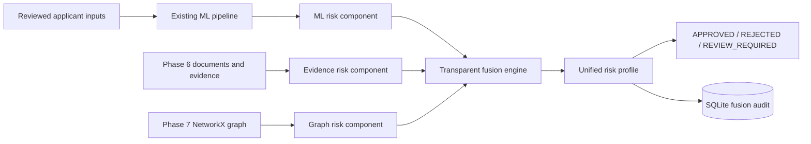

# Phase 8: Multimodal Evidence + ML + Graph Risk Fusion

## Objective

Phase 8 combines three independent decision-support signals: the existing Phase 3 structured ML prediction, Phase 6 evidence quality/consistency, and Phase 7 relationship graph risk. The fusion profile is explainable, confidence-aware, configurable, and able to abstain with `REVIEW_REQUIRED`.

It does not retrain or replace the Gradient Boosting model, claim approval certainty, claim fraud detection, or produce SHAP explanations. It is an academic/demo architecture.

## Architecture



## Components

- **ML risk:** the existing model's `risk_score`, which is the complement of approval probability. Confidence is the larger of approval/rejection probabilities. Model identity is `Gradient Boosting`, version `phase3-gradient-boosting-v1`.
- **Evidence risk:** the complement of the Phase 6 Evidence Consistency Score, with Phase 6 confidence, integrity, missing evidence, and consistency signals preserved.
- **Graph risk:** the existing Phase 7 Graph Risk Score and signals from NetworkX. No duplicate graph scoring logic is introduced.

All component scores are indicators on a 0–100 scale, not probabilities.

## Fusion method and configuration

The default engineering/demo weights are stored in `settings/fusion_settings.py`:

- ML: `0.50`
- Evidence: `0.30`
- Graph: `0.20`

The engine validates that weights are non-negative and sum to 1. Overall risk is the weighted sum. These parameters are not claimed to be scientifically optimal or industry standards. The weight/version configuration is stored with every persisted fusion assessment.

Risk bands are project-defined: LOW through 33, MEDIUM through 66, and HIGH above 66. Confidence levels are derived from weighted component confidence: HIGH at 0.80+, MEDIUM at 0.65+, otherwise LOW.

## Disagreement and review required

The engine detects component disagreement when the range between component scores reaches the configured threshold. Review is also triggered by component review flags or confidence below the configured threshold. The resulting status is `REVIEW_REQUIRED`; there is no fraud-confirmed state.

The final status preserves the existing ML decision when evidence and graph signals do not require review. The status is a recommendation for human review, not an automatic lending outcome.

## Traceability

Each component stores source, confidence, explanation, and signals. ML signals link to model output and applicant feature values. Evidence signals link to Phase 6 checks/documents. Graph signals link to Phase 7 signal evidence and graph features. Raw document text is not returned or logged.

## Scenario analysis

`POST /api/risk/<application_id>/scenario` changes selected demo inputs and returns original risk, simulated risk, and difference. The response explicitly avoids causal approval claims. It does not retrain the model or persist the scenario as a production decision.

## Ablation and calibration

`GET /api/evaluation/fusion` reports the actual Phase 3 selected-model holdout metrics plus a Brier score calculated from the existing labeled holdout. It reports enhanced ablation modes as unavailable because no ground-truth evidence/graph/fusion labels exist. No enhanced metrics are fabricated and saved model probabilities are not modified.

The evaluation reuses the Phase 3 stratified holdout and saved pipeline. It does not fit preprocessing on evaluation data. Public/demo data limitations remain documented.

## APIs

- `GET /api/risk/<application_id>`: unified profile and components.
- `GET /api/risk/<application_id>/components`: component scores and signals.
- `GET /api/risk/<application_id>/explanation`: primary explanations and review flags.
- `GET /api/risk/<application_id>/disagreement`: disagreement analysis.
- `POST /api/risk/<application_id>/scenario`: safe demo scenario analysis.
- `GET /api/risk/<application_id>/traceability`: component-level source traceability.
- `GET /api/evaluation/fusion`: actual baseline/calibration and ablation availability.

## Storage and audit

SQLite adds `fusion_assessments`. Each record stores application/assessment IDs, component scores, overall score, confidence, status, serialized explainable profile, fusion version, and timestamp. No raw document content is stored in the fusion record.

## Testing

Run all tests:

```powershell
.\venv\Scripts\python.exe -m unittest discover -s tests -p "test_*.py" -v
```

Phase 8 tests use synthetic documents and verify weight validation, bounded scores, disagreement review, API persistence, scenario output, and actual baseline evaluation availability.

## Limitations and future Phase 9

The fusion weights and thresholds are engineering parameters. No labeled multimodal ground truth exists for enhanced performance claims. Confidence is system/data confidence, not repayment certainty. Scenario differences are not causal. Detailed SHAP, counterfactual explanations, fairness audit, and calibrated production deployment belong to Phase 9.
